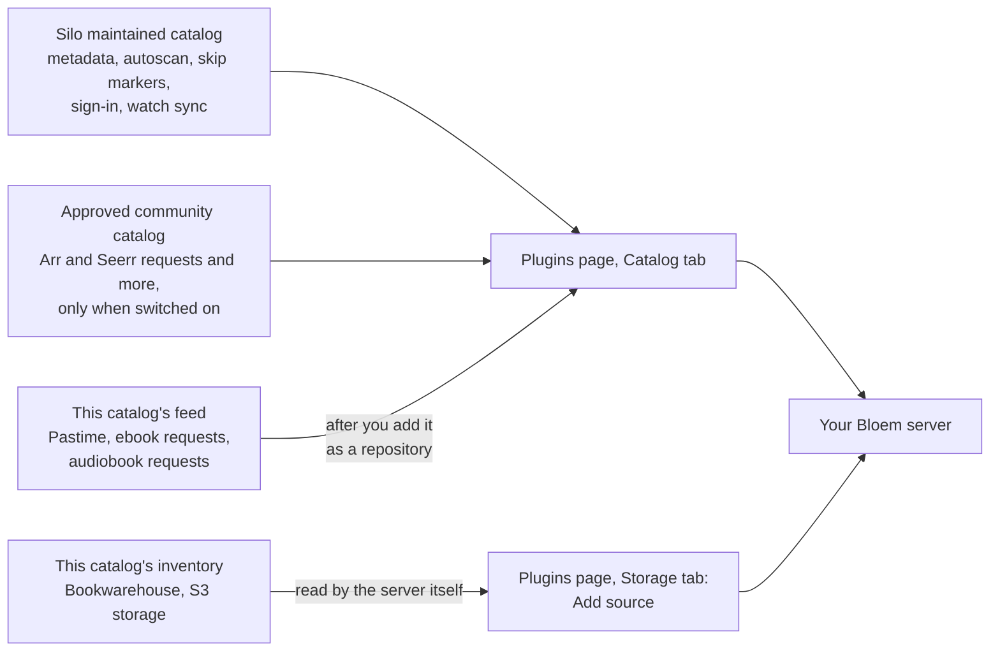
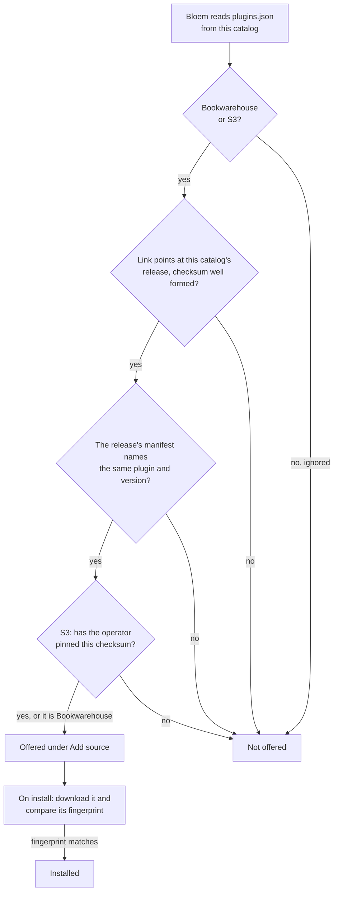

# How the Bloem plugin catalog works

> **Provenance and status.** Bloem plugin page, rewritten on 2026-11-01 and checked
> against `main` at `acdd30d`. It covers this public catalog of Bloem Studios' five
> proprietary plugins (Pastime 0.4.0, Bookwarehouse 0.3.10, S3 storage 0.4.1,
> Bookwarehouse ebook requests 0.1.3 and Audiobook requests 0.1.1) and how Bloem
> Server `main` at `e0320078f` installs them; the technical rules are in the
> [For developers](#for-developers) section.

This page walks through what the catalog publishes, where a Bloem server gets each
kind of plugin, how to install each of the five plugins, and what a release
contains. Two more pages go into detail:
[how to install Bookwarehouse](docs/bookwarehouse-installation.md) and
[how to use the plugin catalogs](docs/user-guide.md). Maintainers read
[how the catalog is maintained](docs/admin-guide.md).

## What this catalog is

A **plugin** is a separate program that Bloem Server starts and talks to, to add a
feature such as a book service or a request service. A **plugin catalog** is a
public list of plugins and where to download them.

This repository is Bloem Studios' plugin catalog. It publishes three things:

- **Releases.** The plugin programs themselves, one download for each kind of
  server, with their **checksums**. A checksum is a fingerprint of a file: change
  one byte and the fingerprint changes, so a server can tell it got the exact file
  that was published.
- **The feed**, [`manifest.json`](manifest.json). A server's plugin catalog reads it
  to offer the **ordinary plugins**, which install like any Silo plugin.
- **The inventory**, [`plugins.json`](plugins.json). It lists all five releases with
  their download links, checksums and requirements. Bloem Server reads it to offer
  the two **native storage providers**: plugins that let a library read files from
  a book service or an S3 bucket instead of a folder on the server.

The plugins' source code is private. Only the programs and their descriptions are
published here, and GitHub's source archives of this repository contain only this
metadata.

## Where Bloem gets its plugins



- **Silo's plugins come from Silo.** Bloem Server is a fork of Silo Server and uses
  Silo's plugins as they are: metadata providers such as TMDB and TVDB, autoscan,
  skip markers, sign-in, request routing and watch sync. Every Bloem server lists
  Silo's **Silo maintained** catalog. Silo's **Approved community** catalog adds
  community plugins when an administrator switches on **Include approved community
  plugins**; the Arr and Seerr request plugins are offered only from there.
- **Bloem's own plugins come from here.** This catalog lists only plugins Bloem
  Studios writes, never a copy of one of Silo's.
- **Bloem's former copies are archived.** Bloem once kept its own copies of Silo's
  plugins, and a community catalog of its own. Both were archived on 2026-11-01; use
  Silo's catalogs for those plugins. Archiving a copy changes nothing on a server
  that already has it installed; see
  [how to use the plugin catalogs](docs/user-guide.md).

## The five plugins

| Plugin | What it does | How it is installed | Runs on |
| --- | --- | --- | --- |
| [Pastime 0.4.0](https://github.com/Bloem-Studios/bloem-plugins/releases/tag/pastime-v0.4.0) | Sends what each connected profile watches to Pastime, a separate watch-tracking service, and brings Pastime's plays, resume points, favourites, watchlist and ratings back, with the removals made in Pastime. | Ordinary plugin, from the feed | Linux (amd64, arm64), macOS (arm64) |
| [Bookwarehouse 0.3.10](https://github.com/Bloem-Studios/bloem-plugins/releases/tag/bookwarehouse-v0.3.10) | Lets a library read EPUB and PDF ebooks, and audiobooks, from a Bookwarehouse book service. | Native storage provider, from the inventory | Linux (amd64, arm64), macOS (arm64) |
| [S3 storage 0.4.1](https://github.com/Bloem-Studios/bloem-plugins/releases/tag/s3-v0.4.1) | Lets a library read files from one S3 bucket, or from every bucket its keys can list. | Native storage provider, from the inventory, once the operator pins it | Linux (amd64, arm64) |
| [Bookwarehouse ebook requests 0.1.3](https://github.com/Bloem-Studios/bloem-plugins/releases/tag/requests-bookwarehouse-v0.1.3) | Sends approved ebook requests to Bookwarehouse. | Ordinary plugin, from the feed | Linux (amd64, arm64), macOS (arm64) |
| [Audiobook requests 0.1.1](https://github.com/Bloem-Studios/bloem-plugins/releases/tag/requests-audiobooks-v0.1.1) | Searches AudiobookBay, abook.link and NZBKing for approved audiobook requests and hands one release to qBittorrent or NZBGet. | Ordinary plugin, from the feed | Linux (amd64, arm64) |

## Installing the plugins

### Add this catalog to a server

The ordinary plugins appear once a server knows this catalog's feed:

1. As a platform administrator, open **Integrations → Plugins** in Bloem's web app.
2. Open the **Catalog** tab. Under **Repositories**, choose **Add repository**.
3. Enter a name, such as "Bloem Studios", and this feed address:

   ```text
   https://raw.githubusercontent.com/Bloem-Studios/bloem-plugins/main/manifest.json
   ```

4. Choose **Add**. Pastime, Bookwarehouse ebook requests and Audiobook requests now
   appear in the catalog, ready to install.

The two storage plugins skip this step: Bloem Server reads the inventory from a
fixed address of its own.

### Pastime

1. Deploy Pastime at database schema 63 or later on the Pastime side first.
   Plugin 0.4.0 needs it for removals; plugin 0.2.0 needs schema 57.
2. Install **Pastime** from the Catalog tab. In its settings, set **Pastime
   address** to the HTTPS address people open Pastime at, for example
   `https://pastime.example.com`.
3. Each person opens Pastime's **Connect Silo** page and creates a key for their
   Pastime profile.
4. In Bloem, they switch to that profile, open **Settings → Watch Providers**,
   choose **Pastime** and paste the key.

A new key replaces the profile's previous one. Disconnecting in Bloem stops
sending, and so does revoking the key in Pastime. Pastime favourites, watchlist and
ratings are added to Bloem. From 0.4.0, a removal made in Pastime reaches Bloem for
that profile only: a favourite, watchlist item or rating removed in Pastime goes when
the connection synced it and its removal settings allow it, and a movie or show
deleted from the Pastime library leaves that profile's Bloem watch history, up to the
time of the deletion. An absent item never removes anything from Bloem.

Pastime 0.2.0 uses Silo's own **watch sync**, the part of the server that talks to
tracking services. Earlier 0.1.x releases needed a Bloem-only connection called
**managed tracking**, which Bloem Server removed on 2026-10-13, so a 0.1.x plugin
can no longer start. Keep a 0.1.x installation disabled and upgrade it in place to
0.2.0 instead of uninstalling it: it keeps the same plugin, so each profile's
connection carries over.

### Bookwarehouse ebook requests

Ebook requests are off by default, and only people in the **default organization**
(Bloem's own direct customers) can make them.

1. Install **Bookwarehouse** storage and create an ebook library from it
   ([how to install Bookwarehouse](docs/bookwarehouse-installation.md)).
2. Install **Bookwarehouse ebook requests** from the Catalog tab.
3. As a platform administrator, acting as the default organization or in the
   Platform context, open **Requests** and its **Ebooks** tab. Under **Ebook
   fulfillment**, tick **Enable ebook requests** and choose **Save ebook request
   policy**.
4. Under **Add Bookwarehouse connection**, give the connection a name, the
   Bookwarehouse address and key, and choose **Add connection**. Bloem's setup
   always orders EPUB; it has no PDF switch. Tick **Allow HTTP for a trusted local
   server** only for a plain-HTTP address on a network you trust.
5. Select the Bookwarehouse ebook library and choose **Save library**. **Test
   connection** checks that Bloem can reach Bookwarehouse.

A viewer then asks for an ebook by its **ISBN** (the number that identifies an
edition), and the request is done when an EPUB or PDF with that ISBN appears in the
library.

### Audiobook requests

1. Install **Audiobook requests** from the Catalog tab.
2. As a platform administrator in the default organization, open the audiobook
   **Requests** page and, under **Audiobook acquisition setup**, choose **Add
   audiobook connection**.
3. Enter the **download client**, qBittorrent or NZBGet or both, with its address
   and login. Switch on abook.link or AI help only if you want them. Bloem stores
   every password and key encrypted.
4. Choose the audiobook library and a **download folder** inside it that is only for
   these downloads. The download client must be able to write there, and the
   library may already hold no more than 10,000 files in that folder.
5. Save, then use **Test connection**.

Good to know:

- **Only the default organization.** The plugin fetches books only for the default
  organization. Other organizations' audiobook requests stay manual: an
  administrator adds the book by hand.
- **Off until you ask.** AI help and abook.link are off by default. AI help needs
  its own OpenAI-compatible address and key. With abook.link on, the plugin may post
  one forum thank-you per request to reveal hidden content.
- **Checked before done.** The plugin checks the downloaded files before it reports
  success, but a download can appear in the library before that check finishes.
  A Usenet download needs the path mapping between the download client and the
  server to finish without an administrator.

### Bookwarehouse and S3 storage

1. Open **Integrations → Plugins** and the **Storage** tab, then choose **Add
   source**.
2. Pick **Install Bookwarehouse** (ebooks), **Audiobooks** beside **Bookwarehouse
   audiobooks**, or **S3** beside **S3-compatible storage**.
3. Give the source its connection, then choose it when you create a library.

Bloem Server trusts a storage release only after checking it against the inventory:



- **Bookwarehouse** is offered as soon as its release is listed. No operator
  approval or restart is needed.
- **S3 storage** is offered only after the **operator**, the person who runs the
  server program, pins its checksum in the server's approvals file. See Bloem
  Server's
  [storage sources](https://github.com/Bloem-Studios/bloem-server/blob/main/docs/architecture/bloem-storage-sources.md)
  page. A Bloem Server older than `99a4a1133` offers the catalog release only on
  Linux amd64; on Linux arm64 the operator then installs it by hand as an approved
  upload. S3 reads
  **immutable object versions** by default, so a file can't change under a reader. **Checked ETag** reads, for buckets without versions, need an
  explicit opt-in and cannot prove the bytes are unchanged.

## What a release contains

| Release | Programs | Checksums | Licence terms and notices | Build record |
| --- | --- | --- | --- | --- |
| Pastime 0.2.0 | 3 | yes | no | no |
| Bookwarehouse 0.3.10 | 3 | yes | yes | yes, plus the linux/amd64 manifest and an example approvals file |
| S3 storage 0.4.1 | 2 | yes | yes | yes, plus the linux/amd64 manifest |
| Bookwarehouse ebook requests 0.1.3 | 3 | yes | yes | yes, plus the linux/amd64 manifest |
| Audiobook requests 0.1.1 | 2 | yes | yes | yes, plus the linux/amd64 manifest |

The **build record** names the source revision a release was built from. No
plugin source is published here.

## Example: a book club server

This example is made up.

Mira runs a Bloem server for a book club, as its platform administrator. She wants
the club's ebooks on Bookwarehouse in Bloem, and members to ask for new ones.

1. On the **Storage** tab she chooses **Add source**, then **Install Bookwarehouse**.
   The server checks the release against the inventory and installs it. She saves
   the Bookwarehouse address and key and creates an ebook library from the source.
2. She adds this catalog's feed as a repository and installs **Bookwarehouse ebook
   requests** from the Catalog tab.
3. On the ebook **Requests** page she enables ebook requests, adds the Bookwarehouse
   connection and selects the library.
4. A member asks for a novel by its ISBN. Mira approves it, Bookwarehouse fetches
   it, and the request is done when the EPUB shows up in the library.

## Who can change what

| Who | What they change |
| --- | --- |
| Platform administrator | Adding this feed as a repository; installing, configuring and upgrading ordinary plugins; storage sources for the platform; upgrading S3 from the catalog; the ebook and audiobook request setup. |
| Organization administrator | Storage sources for their own organization, at public internet addresses only. They cannot upgrade an S3 source from the catalog. Their organization's request queues. |
| A profile | Its own Pastime key under **Settings → Watch Providers**; its own requests. |
| The operator who installs the server | The approvals file that pins S3 releases, the cover cache, and restarts. |
| The storefront (Bloem Garden) | Nothing in this catalog. |
| Bloem Studios maintainers | The releases, `plugins.json` and `manifest.json` in this repository. |

## Words used in the code

| On this page | In the code and files |
| --- | --- |
| Plugin catalog | this repository, `Bloem-Studios/bloem-plugins` |
| Feed | `manifest.json`, a `RepositoryIndex` of `CatalogPackage` entries (`catalog/catalog.go`) |
| Inventory | `plugins.json`, `schema_version` 1 |
| Ordinary plugin | `installation_mode: "ordinary"` in `plugins.json` |
| Native storage provider | `installation_mode: "native"`, serving `bloem.plugin.v1.StorageProvider`; plugin IDs `bloem.storage.bookwarehouse` and `bloem.storage.s3` |
| Release | a GitHub release in this repository, tagged `<name>-v<version>`, such as `bookwarehouse-v0.3.10` |
| Checksum | SHA-256, in each release's `checksums.txt` and in `binaries["<os>/<arch>"].checksum` |
| Silo maintained, Approved community | Bloem Server's `DefaultRepositoryURL` and `ApprovedCommunityRepositoryURL` (`internal/plugins/catalog_channels.go`); the switch is the setting `plugins.include_approved_community_plugins` |
| Watch sync | the `watch_sync_provider.v1` capability |
| Request service | the `request_router.v1` capability |
| Ebook requests switch | the server setting `bloem.requests.ebooks_enabled` |
| Approvals file, pin | the file named by `BLOEM_NATIVE_STORAGE_APPROVALS` |
| Build record | each release's `build.json` |

## For developers

### Releases

| Plugin | Version | Install path |
| --- | --- | --- |
| [Pastime](https://github.com/Bloem-Studios/bloem-plugins/releases/tag/pastime-v0.2.0) | 0.2.0 | Plugin catalog; Pastime release A, Pastime address and one Connect Silo key per profile required |
| [Bookwarehouse](https://github.com/Bloem-Studios/bloem-plugins/releases/tag/bookwarehouse-v0.3.10) | 0.3.10 | Native storage installer; Bloem Server admits the listed release after verifying its URL, checksum and release manifest |
| [S3 storage](https://github.com/Bloem-Studios/bloem-plugins/releases/tag/s3-v0.4.1) | 0.4.1 | Native storage installer; exact-artifact approval (a pin in the host's static approvals) and source configuration required |
| [Bookwarehouse ebook requests](https://github.com/Bloem-Studios/bloem-plugins/releases/tag/requests-bookwarehouse-v0.1.3) | 0.1.3 | Plugin catalog; connection, organization policy and native ebook library binding required |
| [Audiobook requests](https://github.com/Bloem-Studios/bloem-plugins/releases/tag/requests-audiobooks-v0.1.1) | 0.1.1 | Plugin catalog; audiobook acquisition connection, download client and audiobook library binding required |

S3 and Audiobook requests support Linux amd64 and arm64; the other releases also
include macOS arm64. Each release has `plugin-<os>-<arch>` executables and
`checksums.txt` (`<sha256>  plugin-<os>-<arch>` per line). All except Pastime 0.2.0
also carry `BINARY_LICENSE.txt` (the Bloem Studios Proprietary Plugin License),
`third-party-notices.tar.gz`, `<tag>-distribution.tar.gz`, `build.json`
(`repository`, `revision`, `version` and the linux/amd64 `binary_sha256`) and
`manifest.json`, the linux/amd64 executable's own manifest (its `checksum` is the
linux/amd64 digest). Bookwarehouse 0.3.10 also carries
`native-storage-approvals.example.json`. The Pastime 0.2.0 release has only
`checksums.txt` and its three executables.

Every executable prints its manifest with `plugin-<os>-<arch> manifest`. Audiobook
requests 0.1.1 also reports its source commit with `plugin-<os>-<arch> version`
and in its manifest's `metadata.source_revision`
(`1156109364b9ecd9bac19b764b8058bd15fbc403`); the other releases record theirs only
in `build.json`.

### The two files

[`manifest.json`](manifest.json) is the ordinary-plugin feed: a `RepositoryIndex`,
`{"plugins": [...]}`, whose entries each hold `manifest` (the plugin manifest in
protobuf JSON), `repo_url`, `checksums_url` and `binaries`, a map from `"<os>/<arch>"`
to `{url, checksum}`. It lists exactly `bloem.pastime`, `bloem.requests.audiobooks`
and `bloem.requests.bookwarehouse`, sorted by plugin ID. Native Bookwarehouse
storage and S3 have no ordinary plugin capabilities (their manifests declare none)
and must use the native StorageProvider installation path; neither is inserted into
the ordinary manifest with fabricated capabilities. The Pastime entry also carries
the linux/amd64 digest in `manifest.checksum`; the others leave it empty and rely on
per-platform checksums.

[`plugins.json`](plugins.json) (`schema_version` 1) lists all five releases. Each
entry has `plugin_id`, `display_name`, `repository_url` (the private source
repository), `source_version`, `sdk_version`, `installation_mode`, `status`,
`summary`, `requirements`, `license_spdx` (`LicenseRef-Bloem-Proprietary`),
`source_visibility` (`private`), `release_url`, `checksums_url` and `binaries`.

| `plugin_id` | `source_version` | `sdk_version` | `installation_mode` | `status` |
| --- | --- | --- | --- | --- |
| `bloem.pastime` | 0.2.0 | 0.26.0 | `ordinary` | `requires_connection_and_policy` |
| `bloem.storage.bookwarehouse` | 0.3.10 | 0.27.0 | `native` | `requires_native_approval` |
| `bloem.storage.s3` | 0.4.1 | 0.27.0 | `native` | `requires_native_approval` |
| `bloem.requests.bookwarehouse` | 0.1.3 | 0.26.0 | `ordinary` | `requires_connection_and_policy` |
| `bloem.requests.audiobooks` | 0.1.1 | 0.26.0 | `ordinary` | `requires_connection_and_download_client` |

Its `requirements` strings are the published prerequisites, and they match current
Bloem Server behaviour: a listed Bookwarehouse release is admitted automatically while
S3 needs its digest pinned, and an audiobook download folder may hold at most 10,000
catalogued, non-missing files. Bookwarehouse ebook requests 0.1.3 and Bookwarehouse
0.3.10 carry corrected setup texts; earlier releases said audiobook requests "have no
automatic acquisition backend" and that audiobooks need audio-sized cache limits.

### How Bloem Server reads the inventory

Bloem Server's native storage catalog (`internal/plugins/bloem_storage_catalog.go`)
fetches `https://raw.githubusercontent.com/Bloem-Studios/bloem-plugins/main/plugins.json`
(at most 1 MiB, refreshed at most once a minute) and reads only two entries:

| `plugin_id` | Artifact key prefix | Release tag | Needs a pin |
| --- | --- | --- | --- |
| `bloem.storage.bookwarehouse` | `bookwarehouse` | `bookwarehouse-v<version>` | no |
| `bloem.storage.s3` | `s3` | `s3-v<version>` | yes |

For each, it takes the binary for the server's own `<os>/<arch>`; a release without
one is skipped. The URL must be exactly
`https://github.com/Bloem-Studios/bloem-plugins/releases/download/<tag>/plugin-<os>-<arch>`
(https, no credentials, query or fragment) and the checksum 64 lowercase hex digits,
or the refresh fails. It then reads the release's `manifest.json` (at most 1 MiB),
which must name the same plugin ID and version. An S3 row is considered only when
its checksum and version match an artifact pinned in the host's static approvals
(`BLOEM_NATIVE_STORAGE_APPROVALS`); its served manifest must also carry that
checksum, and the pinned manifest is used, never the served one. A Bookwarehouse
row's manifest takes the row's checksum. Because a release's `manifest.json` carries
the linux/amd64 digest, a Bloem Server older than `99a4a1133` (2026-11-01) offers the
S3 catalog row only on linux/amd64; there, on linux/arm64, install S3 as a
manually approved artifact. From `99a4a1133` on, a served manifest naming any binary
of the same release passes, so the arm64 row is offered too. The
artifact key is
`<prefix>-<version>-<os>-<arch>-<sha256>`. Verified rows are cached in
`native-catalog.json` under the native installation root. Installing downloads the
binary (at most 256 MiB, redirects only to `github.com`,
`release-assets.githubusercontent.com` or `raw.githubusercontent.com`) and refuses
it on a SHA-256 mismatch. `checksums_url`, `requirements` and the other fields are
not read.

The server's ordinary catalog reads `manifest.json` only from a repository an
administrator added, through Silo's plugin repository routes (`POST
/api/v2/admin/plugins/repositories`, URL and display name required).

### Plugin details

**Pastime** (`bloem.pastime`, capability `watch_sync_provider.v1`, ID `pastime`).
Auth method API key; media types movie, episode and series; external IDs `tmdb`,
`imdb` and `tvdb`; batches of at most 100; exports watched plays and live playback
(scrobbling); imports, exports and removes favourites and watchlist; imports and
exports ratings. Global config `pastime` has one required field, `pastime_url`
(label **Pastime address**), at most 255 characters, matching
`^https://[^/?#@\s]+/?$`. Bloem Server removed Pastime managed tracking on
2026-10-13 (migration `20261013231500_remove_pastime_managed_tracking`); a 0.1.x
plugin fails at `BindHostBroker` with `FailedPrecondition`. Replace it in place with
the same plugin ID and capability ID, so provider `plugin:<installation>:pastime`
and its `watch_provider_connections` carry over.

**Bookwarehouse ebook requests** (`bloem.requests.bookwarehouse`, capability
`request_router.v1`, ID `bookwarehouse`, media type `book`). Config `connection`:
`allow_http` (default `false`), `allow_pdf` (default `false`) and
`preferred_format` (`epub` or `pdf`, default `epub`). Progress wording: step
"Acquiring", queued "Searching", downloading "Downloading". Bloem Server gates the
lane on `bloem.requests.ebooks_enabled` (exactly `true`; default `false`, set
through `PUT /api/bloem/v1/admin/organization/ebook-request-policy`), admits only
the default organization (`organizations.is_default`), and requires a connection
that advertises `book`, bound to a native Bookwarehouse ebook library.

**Audiobook requests** (`bloem.requests.audiobooks`, capability
`request_router.v1`, ID `audiobooks`, media type `audiobook`, category
`Books/Audiobooks`). Config `connection` covers:

- sources: `audiobookbay_enabled` (default `true`), `audiobookbay_base_url`
  (`https://audiobookbay.lu`), `audiobookbay_search_pages` (1–5, default 2),
  `audiobookbay_resolve_limit` (1–8, default 5), `audiobookbay_trackers` (at most
  20); `abook_enabled` (default `false`), `abook_base_url`
  (`https://abook.link/book`), `abook_auto_thank` (default `true`);
  `nzbking_enabled` (default `true`), `nzbking_base_url` (`https://nzbking.com`),
  `nzbking_standalone` (default `true`);
- download clients: `qbittorrent_url`, `qbittorrent_username`,
  `qbittorrent_category` (default `bloem-audiobooks`), `qbittorrent_save_root`,
  `qbittorrent_stall_hours` (1–720, default 24); `nzbget_url`, `nzbget_username`,
  `nzbget_category` (default `bloem-audiobooks`); `allow_http_download_clients`,
  `allow_private_source_hosts` and `allow_loopback_targets` (all default `false`);
- matching and checks: `min_title_coverage` (0.3–1, default 0.6),
  `min_author_coverage` (0–1, default 0.5), `max_candidates` (3–10, default 10),
  `verify_min_total_mb` (0–10000, default 20), `verify_min_duration_minutes`
  (0–6000, default 30), `verify_local_client_prefix` and `verify_local_prefix`;
- AI: `ai_enabled` (default `false`), `ai_base_url`, `ai_chat_model`,
  `ai_allow_http` (default `false`), `ai_response_format` (`json_object` or
  `json_schema`), `ai_reasoning_effort` (`""`, `none`, `low` or `medium`),
  `ai_parameter_profile` (`standard` or `reasoning`), `ai_min_confidence`
  (0.5–0.99, default 0.75), `ai_max_calls_per_request` (1–20, default 6),
  `ai_timeout_seconds` (5–60, default 20), `ai_max_tokens` (256–4096, default
  1024), `ai_query_expansion` (default `true`), `ai_max_queries` (1–5, default 3)
  and `ai_verify_downloads` (default `true`).

Bloem's audiobook request setup stores the download client, abook.link and AI
credentials encrypted, in the request integration's `abk1.` composite. Bloem Server
dispatches only to `bloem.requests.audiobooks`; a platform-owned integration serves
only the default organization, and ordinary plugin installations are always
platform-owned, so acquisition runs only for the default organization. A download
root may hold at most 10,000 files (`audiobookMaxRootFiles`).

**Bookwarehouse storage** (`bloem.storage.bookwarehouse`) and **S3 storage**
(`bloem.storage.s3`): see [how to install Bookwarehouse](docs/bookwarehouse-installation.md)
and Bloem Server's
[native storage](https://github.com/Bloem-Studios/bloem-server/blob/main/docs/architecture/bloem-native-storage.md)
page. Since 0.4.0, S3 lets a source leave its bucket empty to cover every bucket its keys
can list. It requires immutable object versions by default; checked ETag reads
(`connection.revision_mode: "checked-etag"`) require explicit opt-in and cannot
prove unchanged bytes.

### Development

The catalog code (`catalog/`, `cmd/update-catalog/`) is Apache-2.0 ([LICENSE](LICENSE),
provenance in [NOTICE](NOTICE)). The proprietary license applies to the separately
packaged custom plugin binaries; third-party components retain their own licenses.
Previously published open-source versions retain their licenses.

Go 1.26 or newer (`go.mod` declares `go 1.26.0` and the Bloem SDK `v0.26.0`).
Commands assume the repository root is the cwd:

```sh
GOWORK=off go test -race ./...
GOWORK=off go vet ./...
GOWORK=off go build ./...
```

CI (`.github/workflows/ci.yml`) runs the same three commands. The tests pin the
catalog's contents: `TestInventoryContainsOnlyCustomPluginsWithExplicitPrerequisites`
(the five `plugins.json` entries, their source repositories, versions, SDK versions,
modes and statuses), `TestCustomCatalogDoesNotDuplicateSiloOrAdvertiseUnreadyNativePlugins`
(exactly the three ordinary plugins in `manifest.json`) and
`TestModuleUsesBloemIdentityAndTaggedSDK`. A new release changes the matching test
with the data.

The generic release updater is restricted to an empty source-repository allowlist.
Binary releases hosted here are maintained explicitly with verified checksums; the
updater does not grant automation access to private plugin source. See
[how the catalog is maintained](docs/admin-guide.md).

### Related pages

- [How to install Bookwarehouse](docs/bookwarehouse-installation.md): the storage
  source, the manual approval path and the cover cache.
- [How to use the plugin catalogs](docs/user-guide.md): which catalog each plugin
  comes from.
- [How the catalog is maintained](docs/admin-guide.md): publishing releases, the
  updater and its workflow.
- Bloem Server:
  [storage sources](https://github.com/Bloem-Studios/bloem-server/blob/main/docs/architecture/bloem-storage-sources.md),
  [native storage](https://github.com/Bloem-Studios/bloem-server/blob/main/docs/architecture/bloem-native-storage.md),
  [requests](https://github.com/Bloem-Studios/bloem-server/blob/main/docs/architecture/bloem-requests.md),
  [audiobook requests](https://github.com/Bloem-Studios/bloem-server/blob/main/docs/architecture/bloem-audiobook-requests.md),
  [ebook requests](https://github.com/Bloem-Studios/bloem-server/blob/main/docs/architecture/bloem-ebook-request-foundation.md)
  and [Pastime removal](https://github.com/Bloem-Studios/bloem-server/blob/main/docs/architecture/bloem-pastime-removal.md).
- Silo's catalogs, where shared metadata, autoscan, marker and request plugins
  come from: [Silo maintained](https://github.com/Silo-Server/silo-plugins) and
  [Approved community](https://github.com/Silo-Community/silo-plugins).
