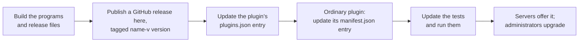

# How the catalog is maintained

> **Provenance and status.** Bloem plugin page, rewritten on 2026-11-01 and checked
> against `main` at `acdd30d`. It covers how Bloem Studios maintainers publish the
> five plugin releases in this catalog, keep `plugins.json` and `manifest.json`
> right, and use the release updater and its workflow; the technical rules are in
> the [For developers](#for-developers) section.

This catalog lists only Bloem Studios' own plugins. This page walks through what
belongs here, how a new release gets listed, what the automatic updater may and may
not do, and how credentials stay out of the public repository. What the catalog
offers to a server is on [how the Bloem plugin catalog works](../README.md).

## What belongs here

- **Only Bloem's own plugins.** Silo's plugins belong in Silo's catalogs, and Bloem
  servers take them from there directly. Bloem's former copies of Silo's plugins,
  and its former community catalog, were archived on 2026-11-01; servers use Silo's
  catalogs for those plugins.
- **Programs, not source.** Official binary releases are hosted in this public
  repository. The plugins' source repositories stay private.
- **Two files with two jobs.** `plugins.json` is the **inventory**: every release,
  its private source repository, public binary release, source version, SDK
  version, installation mode, status and prerequisites. `manifest.json` is the
  **feed** for ordinary plugins. Keep them separate.

Pastime 0.2.0, Bookwarehouse ebook requests 0.1.4 and Audiobook requests 0.1.2 are
in the feed. Bookwarehouse 0.3.10 and S3 storage 0.4.1 are only in the inventory:
they use Bloem Server's separate native storage path.

## Listing a new release

Releases hosted here are listed by hand:

1. Build the programs for each platform the plugin supports, with
   `checksums.txt`, the licence terms, the third-party notices, the build record and
   the program's own manifest.
2. Publish a GitHub release in this repository, tagged with the plugin's name and
   version, such as `bookwarehouse-v0.3.10`.
3. Point the plugin's `plugins.json` entry at the new release: version, release
   links and checksums. Check every checksum against the published files.
4. For an ordinary plugin, update its `manifest.json` entry the same way.
5. Update the inventory test to the new version and run the tests.

**Publishing is not switching on.** A listed release changes nothing on a server
until an administrator installs or upgrades it. For S3, a server offers the new
release only after its operator pins the new checksum.

## The automatic updater

The repository also has an **updater**: a program and a GitHub workflow that can
add an ordinary plugin's release to the feed by themselves. Today it may update no
plugin at all. Its list of allowed source repositories is empty, so every private
plugin repository is refused, and the releases hosted here are kept up to date by
hand.

Before a future plugin uses it:

1. Review the plugin's host compatibility, presentation, platforms and how its
   release is packaged.
2. Add its repository to the updater's allowed list, with tests, on purpose.
3. Publish a stable release with exactly three programs, one for each supported
   platform, plus `checksums.txt`.
4. Start the **Update Catalog** workflow with the source repository and tag.

The workflow checks every program, checks that the program describes itself the
same way as its source, checks that a second run gives the same file, runs the
tests, and commits only `manifest.json`.

## Keeping credentials out

- CI uses public modules and no credentials.
- The updater reads GitHub's public API with the workflow's own read-only token.
- One secret, `BLOEM_CATALOG_PUSH_TOKEN`, is used only for the final push, and only
  with access to this repository.
- Never put a token in source, URLs, metadata, programs or logs. No private mirror
  is needed: the catalog and release addresses are public GitHub URLs.

## Example: listing a new Bookwarehouse release

This example is made up.

A maintainer builds Bookwarehouse 0.3.11. She publishes a release tagged
`bookwarehouse-v0.3.11` with the three programs and the release files, points the
`bloem.storage.bookwarehouse` entry in `plugins.json` at it with the new
checksums, changes the expected version in the inventory test, and runs the tests.
The next time a server refreshes its storage catalog, **Add source** offers 0.3.11;
existing Bookwarehouse sources stay on 0.3.10 until an administrator upgrades them.

## Who can change what

| Who | What they change |
| --- | --- |
| Bloem Studios maintainers | Releases, `plugins.json`, `manifest.json`, the updater's allowed list and the tests. |
| The Update Catalog workflow | Only `manifest.json`, only for an allowed repository (none today). |
| Repository administrators | The `BLOEM_CATALOG_PUSH_TOKEN` secret. |
| Server administrators | Whether and when their server installs or upgrades a listed release. |
| The operator who installs a server | S3 pins in that server's approvals file. |

## Words used in the code

| On this page | In this repository |
| --- | --- |
| Inventory | `plugins.json`, checked by `TestInventoryContainsOnlyCustomPluginsWithExplicitPrerequisites` (`catalog/inventory_test.go`) |
| Feed | `manifest.json`, checked by `TestCustomCatalogDoesNotDuplicateSiloOrAdvertiseUnreadyNativePlugins` (`catalog/identity_test.go`) |
| Updater | `cmd/update-catalog` (`main.go`), using `catalog.BuildPackageFromRelease` and `catalog.UpsertPackage` |
| Allowed list | `allowedRepositories` in `cmd/update-catalog/main.go`, empty |
| Update Catalog workflow | `.github/workflows/update-catalog.yml` |
| CI | `.github/workflows/ci.yml` |
| Push secret | `BLOEM_CATALOG_PUSH_TOKEN` |

## For developers

### Inventory and feed

Maintain `plugins.json` as the custom source inventory: stable plugin ID, private
source repository, public binary release, source version, SDK version,
installation mode, status and prerequisites. Keep it separate from the installable
`manifest.json` feed. Bloem Server reads `plugins.json` from `main` for the two
native storage providers, so their entries must keep the exact release URLs
(`https://github.com/Bloem-Studios/bloem-plugins/releases/download/<tag>/plugin-<os>-<arch>`),
lowercase SHA-256 checksums and tag prefixes `bookwarehouse-v` and `s3-v`, and each
release must carry `manifest.json` naming the same plugin ID and version (see
[how Bloem Server reads the inventory](../README.md#how-bloem-server-reads-the-inventory)).
`TestInventoryContainsOnlyCustomPluginsWithExplicitPrerequisites` pins
`schema_version` 1, exactly five entries and, for each, its source repository under
`https://github.com/Bloem-Studios/`, source version, SDK version, installation mode,
status and a nonempty requirements list.

Bookwarehouse uses native StorageProvider admission: Bloem Server admits a listed
release automatically after verifying it, and an approval that pins the exact
artifact version and SHA-256 is needed only for a manually supplied executable. S3
needs that pin for catalog releases too. Pastime 0.2.0 is an ordinary
`watch_sync_provider.v1` plugin; it needs Pastime release A (database schema 57),
and no Bloem host extension. Publishing binaries is not production activation.

`manifest.json` must list exactly `bloem.pastime`, `bloem.requests.audiobooks` and
`bloem.requests.bookwarehouse`, in that order
(`TestCustomCatalogDoesNotDuplicateSiloOrAdvertiseUnreadyNativePlugins`); native
storage stays outside the ordinary installer. `TestModuleUsesBloemIdentityAndTaggedSDK`
requires module `github.com/Bloem-Studios/bloem-plugins`, SDK
`github.com/Bloem-Studios/bloem-plugin-sdk v0.26.0` and no `replace` directive.

### Updater

`go run ./cmd/update-catalog -repo <owner/name> -tag <tag> [-manifest manifest.json]`
refuses a repository that is not in `allowedRepositories` (empty).
`TestDuplicateAndUnreadyRepositoriesCannotReenterCatalog` keeps Bloem's former
copies of Silo's plugins, Bookwarehouse, Pastime, any other repository and the empty
string out. For an allowed repository it:

1. fetches the release (`/repos/<repo>/releases/tags/<tag>`) and the source
   `manifest.json` at that tag (`/repos/<repo>/contents/manifest.json?ref=<tag>`),
   following no redirects;
2. requires exactly four assets, `checksums.txt`, `plugin-darwin-arm64`,
   `plugin-linux-amd64` and `plugin-linux-arm64`, each with the API URL
   `https://api.github.com/repos/<repo>/releases/assets/<id>` and browser URL
   `https://github.com/<repo>/releases/download/<tag>/<name>`;
3. downloads them through the API (at most four redirects, dropping the
   `Authorization` header on redirect) and requires `checksums.txt` to have exactly
   three lines, each a SHA-256 and a bare asset name, mapping each binary exactly once
   to its matching digest;
4. requires the tag to be exactly `v<version>` matching the source manifest's
   `version`, `silo_api_version` `v1`, and exactly the three supported platforms;
5. when the runner's own platform binary is present, runs `<binary> manifest` with
   only `PATH` in its environment and requires its plugin ID, version, API version,
   `source_url` and `publisher_url` to match the source, and its checksum to be the
   binary's SHA-256;
6. builds the entry (`catalog.BuildPackageFromRelease`: published, not draft, not
   prerelease, at least one capability with type and ID, complete catalog
   presentation for the repository URL, every advertised platform present, the
   manifest `checksum` cleared in favour of per-platform checksums) and upserts it
   sorted by plugin ID (`catalog.UpsertPackage`).

Because the tag must be `v<version>`, the prefixed tags of the releases hosted here
(`pastime-v0.2.0` and so on) are outside its path; they are maintained by hand.

### Update Catalog workflow

`.github/workflows/update-catalog.yml` runs on `repository_dispatch` type
`plugin_release_published` (`client_payload.repo`, `client_payload.tag`) or
`workflow_dispatch` (inputs `repo`, `tag`), in concurrency group
`plugin-catalog-update` without cancelling. With `contents: read`, Go 1.26 and no
module cache, it runs `GOWORK=off go test ./...`, runs the updater twice and
compares the outputs (`cmp`), validates the JSON with `jq`, runs the tests again,
and then, only if `manifest.json` changed, commits it as `github-actions[bot]`,
rebases on `main` and pushes. `BLOEM_CATALOG_PUSH_TOKEN` appears only in that final
step, handed to Git through a temporary `GIT_ASKPASS` script.

`TestPublicWorkflowsKeepCredentialsScopedAndNonPersistent` requires both workflows to
set `persist-credentials: false` and `cache: false`, forbids
`secrets.BLOEM_MODULES_TOKEN`, `secrets.BLOEM_CATALOG_SOURCE_TOKEN`,
`gh auth setup-git`, `visibility public`, `gh release`, `docker push`,
`npm publish` and `pull_request_target`, and requires the push secret to appear
exactly once, in the final push step. `TestNativeValidationDoesNotInheritSourceCredential`
keeps the native manifest check from inheriting the updater's token.

CI (`.github/workflows/ci.yml`) runs on pull requests and pushes to `main` with
`contents: read`: `GOWORK=off go test -race ./...`, `go vet` and `go build`.

CI uses public modules without credentials. The updater uses a read-only GitHub
token for public API reads. Configure `BLOEM_CATALOG_PUSH_TOKEN` only for the final
catalog push, with access limited to this repository. Never put tokens in source,
URLs, metadata, binaries or logs. No private static mirror is needed for public
GitHub catalog and release URLs.

### Forks and versions

Silo and Bloem fork release numbers are independent. A larger fork version can
still be based on older upstream code; compare source and behavior when deciding
whether to adopt a release. Removing a fork does not migrate an existing installed
plugin, its configuration, its database repository association or its binary.
Verify those separately during an actual server rollout.

### Releases

Official custom binary releases are hosted in this public catalog repository.
Plugin source repositories remain private. Releases contain platform executables
and verified SHA-256 checksums; all except Pastime 0.2.0 also contain proprietary
terms and third-party notices. The ordinary updater remains disabled for private
source repositories. The catalog's own code is Apache-2.0; [NOTICE](../NOTICE)
records its import from Silo's plugin catalog.

Related pages:

- [How the Bloem plugin catalog works](../README.md), the front page.
- [How to use the plugin catalogs](user-guide.md).
- [How to install Bookwarehouse](bookwarehouse-installation.md).
