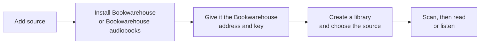

# How to install Bookwarehouse 0.3.11

> **Provenance and status.** Bloem plugin page, rewritten on 2026-11-01 and checked
> against `main` at `acdd30d`. It covers installing the Bookwarehouse 0.3.11 native
> storage provider on Bloem Server `main` at `e0320078f`, from the catalog or by hand,
> and its cover cache; the technical rules are in the
> [For developers](#for-developers) section.

**Bookwarehouse** is a book service. Its storage plugin lets a Bloem library read
EPUB and PDF ebooks, or audiobooks, straight from Bookwarehouse instead of from a
folder on the server. This page walks through the usual way to install it, the
manual way for an operator who supplies the program by hand, and the cover cache
that keeps book covers quick.

## What kind of plugin it is

Bookwarehouse is a **native storage provider**: a plugin that hands Bloem lists of
files and the bytes of a file when Bloem asks. It is not an ordinary plugin, so it
never appears in the plugin **Catalog** tab, and nobody should list it there with
made-up capabilities. A server installs it from the **Storage** tab, from this
catalog's inventory, `plugins.json`.

One installation serves one kind of book. Install it once for ebooks and once more
for audiobooks.

## The usual way: from the Storage tab

1. Open **Integrations → Plugins** and the **Storage** tab, then choose **Add
   source**.
2. For ebooks, choose **Install Bookwarehouse**. For audiobooks, choose
   **Audiobooks** beside **Bookwarehouse audiobooks**, then enter the
   **Bookwarehouse server URL** and **API key** and choose **Install audiobooks**.
3. For ebooks, open the new source and enter the **Bookwarehouse server URL** and
   **API key**, then choose **Save connection**. Bloem stores the key encrypted and
   never shows it again.
4. Create a library and choose the Bookwarehouse source as where it reads from.
   Installing alone neither creates a library nor scans one.
5. Let the library scan, then check that books list, show their covers and open.

Bloem checks the release before it installs it: the program must match the
fingerprint published in this catalog's inventory. No approval file and no restart
are needed. An organization administrator can add Bookwarehouse for their own
organization too, but only at a public internet address.

## The manual way: an operator supplies the program

Use this when the server should run a Bookwarehouse program that an operator
downloaded and reviewed, instead of the one the catalog offers.

1. Download the program for your server from the
   [0.3.11 release](https://github.com/Bloem-Studios/bloem-plugins/releases/tag/bookwarehouse-v0.3.11),
   with `checksums.txt`, the licence and the third-party notices.
2. Check its SHA-256 fingerprint against `checksums.txt` before you make it
   runnable.
3. Write an **approvals file**: a small file the server reads at start-up that
   names each program it may install, with its fingerprint and description.
4. Point the server at that file, restart it, and install the program through the
   native storage administration routes.

The release's `native-storage-approvals.example.json` shows the format. It is an
example, never an active approval.

## The cover cache

Bloem keeps a copy of each book cover someone has viewed. Before the first copy, it
can check a **cover cache**: a separate Redis store that remembers recently fetched
covers, so Bookwarehouse isn't asked twice. It is optional. Without it, covers are
simply read from Bookwarehouse.

Give the cover cache its own Redis, with a memory limit and LRU eviction (the least
recently used covers go first when it fills up). Never reuse the server's main
Redis: it holds sign-ins and must never drop them to make room. Covers in the cache
expire after 30 days and are fetched again after eviction.

## Example: ebooks and audiobooks from one Bookwarehouse

This example is made up.

Jonas runs a Bloem server whose books live on a Bookwarehouse service at
`https://books.example.com`. He installs Bookwarehouse twice from the Storage tab:
once with **Install Bookwarehouse** for ebooks, once with **Install audiobooks** for
audiobooks. He creates an ebook library on the first source and an audiobook
library on the second. When he later adds a cover cache, the first visit to the
ebook library fetches each cover once, and later visits are served from Bloem's
own copies.

## Who can change what

| Who | What they change |
| --- | --- |
| Platform administrator | Bookwarehouse sources for the platform; upgrades; libraries that use them. |
| Organization administrator | Bookwarehouse sources for their own organization, at a public internet address. |
| The operator who installs the server | The approvals file for manually supplied programs, the cover cache, restarts. |
| Viewers | Nothing here; they read and listen to the books. |

## Words used in the code

| On this page | In the code and files |
| --- | --- |
| Bookwarehouse storage plugin | plugin ID `bloem.storage.bookwarehouse`, serving `bloem.plugin.v1.StorageProvider` |
| Inventory | `plugins.json`, read by Bloem Server's native storage catalog (`internal/plugins/bloem_storage_catalog.go`) |
| Approvals file | the JSON file named by `BLOEM_NATIVE_STORAGE_APPROVALS` (`nativestorage.LoadApprovals`) |
| Storage source | `bloem_storage_sources`; an installation in `plugin_installations` marked native in `bloem_storage_installations` |
| Ebooks or audiobooks | `config.connection.content`: `ebooks` (the default) or `audiobooks` |
| Native storage administration | `/api/bloem/v1/admin/platform/native-storage` and `/api/bloem/v1/admin/organization/native-storage` |
| Cover cache | the Redis named by `BLOEM_STORAGE_COVER_CACHE_URL` |

## For developers

### Host approval

Bloem Server admits Bookwarehouse releases listed in `plugins.json` automatically,
after checking the URL, checksum and release `manifest.json` (see
[how Bloem Server reads the inventory](../README.md#how-bloem-server-reads-the-inventory)).
`BLOEM_NATIVE_STORAGE_APPROVALS` is optional for those releases. It holds manually
supplied additional artifacts, and the pins that S3 catalog releases need.

For a manually supplied executable, an operator must review the exact executable,
its `manifest` output, SHA-256, OS and architecture. The included example map does
not grant approval automatically. Set `BLOEM_NATIVE_STORAGE_APPROVALS` to a protected
absolute JSON file containing the reviewed records. The loader expects artifact key →
`{manifest, checksum, os, arch}`; `manifest` is the plugin manifest as protobuf JSON.
The loader (`nativestorage.LoadApprovals`) requires:

- an absolute, clean path with no symlinks in it;
- every parent directory owned by root or the server user, and not writable by
  group or others (a root-owned sticky directory is allowed);
- a regular file opened without following links, owned by root or the server user,
  with no write bits and no group or other bits (mode 0400 is the usual choice),
  at most 1 MiB.

An empty variable means no manual approvals; a set but invalid path stops the
server at start-up. The file is read once at start, so restart the server after
updating it.

Linux amd64 additionally has its extracted manifest in the release (`manifest.json`)
and an example approval map. For Linux arm64 or macOS arm64, extract the manifest by
running the downloaded executable's `manifest` command on the matching platform and
use its exact manifest and SHA-256 in the operator-reviewed map.

### Install through native storage administration

Obtain a current signed administrative context from `POST /api/bloem/v1/admin/session`.
Use `/api/bloem/v1/admin/organization/native-storage` or the corresponding platform
scope, `/api/bloem/v1/admin/platform/native-storage`. `GET /artifacts` lists the
artifacts available to that server process (catalog releases and static approvals);
it adds `catalog` and `config_schema` to each.

- **Catalog install** (what the web app does): `POST /catalog/installations` with a
  JSON body of `artifact_key`, `provider_source_id`, `root_entry_id`, `enabled` and
  `config`. The server downloads the release from the fixed catalog URL and checks
  its SHA-256 before the transactional source installation. The web app uses
  `provider_source_id` `bookwarehouse_<hex>` with `root_entry_id` `root` and an
  empty `config` for ebooks (the connection is saved afterwards with `PUT
  /sources/{source_key}/configuration`), and `bookwarehouse_audio_<hex>` with
  `root_entry_id` `audio-root` and the full connection for audiobooks.
- **Manual install**: `POST /installations` with exactly two multipart parts:
  `binary` containing the raw executable and `request` containing JSON with
  `artifact_key`, `provider_source_id`, `root_entry_id`, `enabled` and `config`.
  None of those five may be missing or `null` (the same holds for the catalog
  install); the three strings are nonempty UTF-8, at most 1024 bytes, with no NUL. Only the platform scope accepts `organization_id`. An upload cannot
  approve its own checksum: `artifact_key` must name an approved artifact.

The protected connection object belongs under `config.connection`; it contains the
Bookwarehouse `base_url`, `api_key`, `source_id` and `source_name`, and `content`:
`ebooks` (the default) or `audiobooks`. Use a separate installation for each; do not
change `content` on a populated source. Keep credentials in backend configuration;
never place them in catalog metadata or release files. `provider_source_id` must
match the configured source ID.

In the organization scope, `connection.base_url` must pass the endpoint guard
(`nativestorage.CheckServiceBaseURL`): a public address on port 443, 7480, 8443, 9000
or 9443; `allow_loopback_http` and `allow_insecure_http` are refused
(`s3_endpoint_rejected`) and case-variant keys are invalid.

After installation, create a library referring to the returned native `source_key`,
rather than filesystem paths. Installation alone neither creates a library nor scans
it. Backend acceptance must verify real listing, metadata, cover and download
behavior. Browsing below the ebook format folders also requires the Bookwarehouse
`GET /api/v1/books/folders` operation; a root listing alone does not exercise it.

`plugins.json` still lists, for this release, "Operator approval of the exact
packaged plugin version and binary SHA-256" among its requirements. That text
predates automatic catalog admission (Bloem Server `5268a8ce5`, 2026-10-09); it now
applies only to the manual path.

### Ebook cover cache

Configure a dedicated Redis through `BLOEM_STORAGE_COVER_CACHE_URL`. Give that Redis
a memory limit and LRU eviction (`maxmemory`, `maxmemory-policy allkeys-lru`). Do
not reuse the main application Redis, which runs without eviction and holds
sessions and grants. Covers expire after 30 days (`storageCoverCacheTTL`) and can be
refetched after eviction. Keys hold the content ID and cover revision, so a changed
cover is a new key. An invalid URL disables the cache with a warning; an unreachable
one is logged at start and skipped (250 ms dial, 500 ms read and write timeouts, no
retries). A suitable shape is a separate 512 MiB cache with `allkeys-lru`, no
persistence and no published port.

### Related pages

- [How the Bloem plugin catalog works](../README.md): the five plugins and the
  inventory.
- Bloem Server:
  [storage sources](https://github.com/Bloem-Studios/bloem-server/blob/main/docs/architecture/bloem-storage-sources.md)
  and
  [native storage](https://github.com/Bloem-Studios/bloem-server/blob/main/docs/architecture/bloem-native-storage.md),
  which hold the scanning, cover and reading rules.
