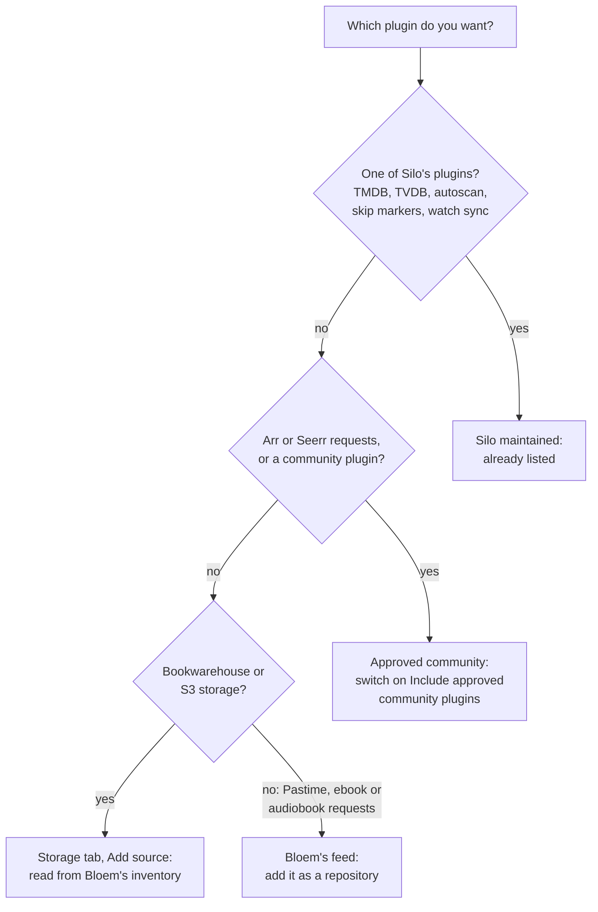

# How to use the plugin catalogs in Bloem

> **Provenance and status.** Bloem plugin page, rewritten on 2026-11-01 and checked
> against `main` at `acdd30d`. It covers which plugin catalog a Bloem Server (`main`
> at `e0320078f`) administrator uses for each kind of plugin, and what publishing a
> catalog does and does not change; the technical rules are in the
> [For developers](#for-developers) section.

A Bloem server can read plugins from three catalogs. This page walks through which
one to use for which plugin, how to add Bloem's own catalog, and what happens to
plugins installed from Bloem's former copies, which were archived on 2026-11-01.
The plugins themselves are described on
[how the Bloem plugin catalog works](../README.md).

## Which catalog to use



- **Silo maintained.** Silo's own catalog. Every Bloem server lists it, and it is
  where ordinary Silo plugins come from: metadata providers, autoscan, skip markers,
  sign-in and watch sync. Its programs speak the same plugin protocol (v1) as
  Bloem's.
- **Approved community.** Silo's catalog of community plugins that Silo's
  maintainers reviewed. It is off until an administrator switches on **Include
  approved community plugins** on the **Catalog** tab. Silo moved its Arr and Seerr
  request plugins there, and Bloem offers them only from there.
- **Bloem's catalog.** This repository, for Bloem Studios' own plugins. Its
  **feed** lists Pastime, Bookwarehouse ebook requests and Audiobook requests once
  an administrator adds it as a repository. Its **inventory** lists every release,
  and Bloem Server reads it by itself to offer Bookwarehouse and S3 storage under
  **Add source**.

## Add Bloem's catalog

1. As a platform administrator, open **Integrations → Plugins** and the **Catalog**
   tab.
2. Under **Repositories**, choose **Add repository**.
3. Enter a name and this address, then choose **Add**:

   ```text
   https://raw.githubusercontent.com/Bloem-Studios/bloem-plugins/main/manifest.json
   ```

The repository's front page is
[github.com/Bloem-Studios/bloem-plugins](https://github.com/Bloem-Studios/bloem-plugins).

## Bloem's former copies

Bloem once kept its own copies of Silo's plugins, and a community catalog of its
own. Both were archived on 2026-11-01; use Silo's catalogs for those plugins.

Archiving does not touch a server. A plugin installed from a former copy keeps
running with its settings, its link to the repository it came from, and its
program, until an administrator changes it. Moving to Silo's version is a change
to make on purpose, and to check afterwards:

- A larger version number on a Bloem copy does not mean newer code. Bloem's copies
  and Silo's releases were numbered independently.
- The same plugin protocol does not mean the same settings or the same behaviour.
  Compare a Silo release with the copy before relying on it.

## What publishing does not change

- Publishing a release in a catalog changes no installed plugin and no account. A
  server picks up a new version only when an administrator installs or upgrades it.
- Passwords and keys belong in each server's own protected settings, never in
  catalog metadata or release files.

## Example: request plugins after the move

This example is made up.

Priya administers a Bloem server that used Bloem's former copy of the Seerr request
plugin. After the archive, she opens the **Catalog** tab and finds no Seerr plugin
listed. She switches on **Include approved community plugins**, and Seerr appears
from Silo's Approved community catalog. She installs it, enters the Seerr address
and key in its settings, sends a test request, and only then removes the old copy.

## Who can change what

| Who | What they change |
| --- | --- |
| Platform administrator | Adding or removing repositories; the **Include approved community plugins** switch; installing, upgrading and removing plugins. |
| Organization administrator | Storage sources for their own organization only. |
| The operator who installs the server | Protected settings, such as the approvals file and passwords kept outside the web app. |
| Viewers | Nothing here. |

## Words used in the code

| On this page | In Bloem Server and this repository |
| --- | --- |
| Silo maintained | `DefaultRepositoryName`, URL `https://raw.githubusercontent.com/Silo-Server/silo-plugins/main/manifest.json`, managed key `official`, source kind `silo` |
| Approved community | `ApprovedCommunityRepositoryName`, URL `https://raw.githubusercontent.com/Silo-Community/silo-plugins/main/manifest.json`, managed key `approved-community`, source kind `approved_community` |
| Include approved community plugins | server setting `plugins.include_approved_community_plugins` (default `false`) |
| A repository an administrator added | source kind `external`, created with `POST /api/v2/admin/plugins/repositories` |
| Bloem's feed | `manifest.json` in this repository |
| Bloem's inventory | `plugins.json` in this repository |

## For developers

- Bloem Server defines both managed catalogs in `internal/plugins/catalog_channels.go`.
  `silo.requests.arr` and `silo.requests.seerr` are approved-community plugins: the
  catalog offers them only from a repository whose source kind is
  `approved_community` (`catalogEntriesForDiscovery` in `internal/plugins/service.go`).
  When the setting first applied, existing installations were moved to that
  repository without changing configuration
  (`plugins.approved_community_migrated_plugin_count`).
- Silo's plugin binaries use the same v1 plugin protocol (`silo_api_version` `v1`).
  Runtime compatibility does not imply identical configuration or provider behavior
  between an older fork and a newer upstream release.
- Silo and Bloem fork release numbers are independent. A larger fork version can
  still be based on older upstream code; compare source and behavior when deciding
  whether to adopt a release. Removing a fork does not migrate an existing installed
  plugin, its configuration, its database repository association or its binary.
  Verify those separately during an actual server rollout.
- The feed `manifest.json` lists Pastime 0.4.1, Audiobook requests 0.1.0 and
  Bookwarehouse ebook requests 0.1.3. The inventory `plugins.json` includes all five
  custom plugins, their public binary download URLs, checksums and prerequisites.
  It is not an ordinary installer feed, but Bloem Server reads it directly for the
  two native storage providers (`internal/plugins/bloem_storage_catalog.go`).
- **Bookwarehouse:** native EPUB/PDF and audiobook StorageProvider. Bloem Server
  admits the listed [0.3.11 release](https://github.com/Bloem-Studios/bloem-plugins/releases/tag/bookwarehouse-v0.3.11)
  after verifying it; a manually supplied executable needs an exact-artifact approval
  ([how to install Bookwarehouse](bookwarehouse-installation.md)).
- **Pastime:** watch sync through Silo's `watch_sync_provider.v1`. Pastime at database
  schema 63 or later must be deployed before plugin 0.4.1.
- Catalog publication does not change live installed plugins or customer accounts.
  Keep secrets in protected backend configuration, never catalog metadata.

Related pages:

- [How the Bloem plugin catalog works](../README.md), the front page.
- [How the catalog is maintained](admin-guide.md).
- [Silo maintained](https://github.com/Silo-Server/silo-plugins) and
  [Approved community](https://github.com/Silo-Community/silo-plugins), Silo's
  catalogs.
